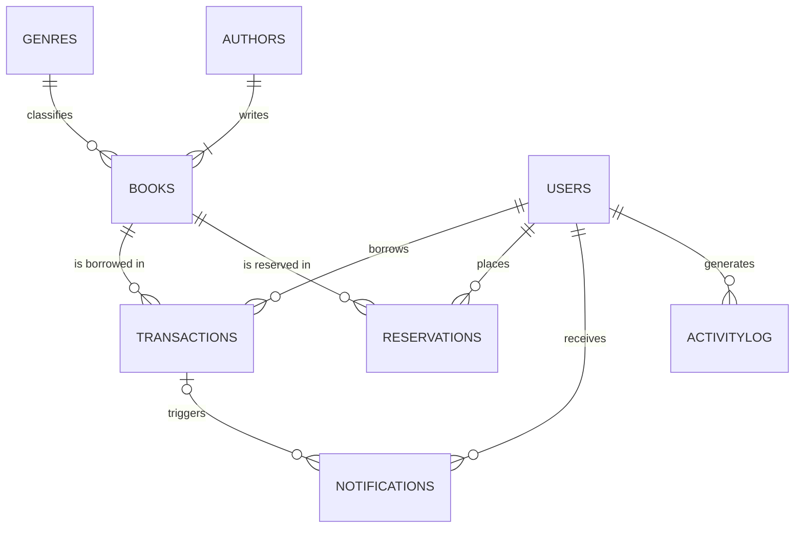

# Library Management System

A MySQL-backed library management system: a normalized (3NF) relational schema, business logic in stored procedures and triggers, reporting views, and a Python desktop app on top. Built as my Honors Project for CSE 3330 (Database Systems) at UT Arlington. It is a teaching and portfolio project: a worked example of relational design, procedural SQL and a desktop front end, not a production library system.

## What it does

- **Catalog:** books with one author and one genre each, ISBNs, and total vs. available copies.
- **Members:** registration, membership status (active / inactive / suspended) and last-activity tracking.
- **Circulation:** checkout and return with automatic due dates and fines. A late return costs $0.50 per day, with no grace period or cap; the loan length is a parameter of `CheckoutBook`. Returning a book does not send a notification (overdue and due-soon notices come from triggers).
- **Reservations:** reserve a book even while it is checked out, with expiry dates.
- **Automation:** triggers flag a loan as overdue when its row is updated, send overdue and due-soon notifications, reject checkouts with no copies left, expire stale reservations and write an activity log.
- **Analytics:** views and ten ready-made reports for librarians.

## Database at a glance



The full diagram with every column, key and index, plus more diagrams (all rendered natively by GitHub): foreign-key delete rules, status lifecycles, flowcharts for each stored procedure, a trigger map, a checkout sequence diagram, view dependencies, the app's screen map and the build order. See [docs/ARCHITECTURE.md](docs/ARCHITECTURE.md).

## Repository layout

```
database/
  01_create_tables.sql        schema: 8 tables, keys, indexes, CHECK constraints
  02_insert_data.sql          sample genres, authors, books, users and transactions
  03_stored_procedures.sql    ReserveBook, CheckoutBook, ReturnBook, GetUserBorrowingHistory
  04_triggers.sql             8 triggers (overdue, notifications, availability, activity log)
  05_queries_and_views.sql    example queries + 5 views
  06_reports.sql              10 analytics reports
app/
  library_app.py              Tkinter desktop app
  requirements.txt
docs/
  ARCHITECTURE.md             ER diagram, flows, trigger map, view dependencies, app map
LICENSE                       MIT
```

### Schema

`Genres`, `Authors`, `Books`, `Users`, `Transactions`, `Reservations`, `Notifications`, `ActivityLog`.

### Stored procedures

| Procedure | Purpose |
| --- | --- |
| `ReserveBook` | Place a reservation for a user |
| `CheckoutBook` | Check a book out and update availability |
| `ReturnBook` | Return a book and compute any fine |
| `GetUserBorrowingHistory` | A member's full borrowing history |

### Views

`vw_OverdueBooks`, `vw_UserDashboard`, `vw_PopularGenres`, `vw_BookInventory`, `vw_UserActivitySummary`.

### Reports (`06_reports.sql`)

Monthly borrowing statistics, most active users, most borrowed books, overdue notifications sent, reservation trends, genre performance, daily operations summary, fine collection summary, author popularity and user retention.

## Getting started

**Requirements:** MySQL 8.0.16 or newer (the schema uses `CHECK` constraints) with the `mysql` command-line client on your PATH, and Python 3.9+. The app talks to MySQL through `mysql-connector-python`, which the pip step below installs.

1. Create the database, in order. Note that `01_create_tables.sql` drops and recreates `LibraryManagementSystem`.

   ```bash
   mysql -u root -p < database/01_create_tables.sql
   mysql -u root -p < database/02_insert_data.sql
   mysql -u root -p < database/03_stored_procedures.sql
   mysql -u root -p < database/04_triggers.sql
   mysql -u root -p < database/05_queries_and_views.sql
   mysql -u root -p < database/06_reports.sql   # optional: runs the report queries
   ```

2. Run the app:

   ```bash
   pip install -r app/requirements.txt
   export LMS_DB_USER=root
   export LMS_DB_PASSWORD=your-password   # PowerShell: $env:LMS_DB_PASSWORD="your-password"
                                          # Windows cmd:  set LMS_DB_PASSWORD=your-password
   python app/library_app.py
   ```

   It connects to `localhost` and the `LibraryManagementSystem` database.

3. Sign in. Choose **user** and enter the email of a member from the sample data (or register one), or choose **librarian** and use the demo account `admin@library.com` (no password). Step 1 loads sample data, so the dashboard has something to show.

## Status

The database layer (schema, procedures, triggers, views, reports) is implemented and tested on MySQL 8.0: checkout (including a title's last copy), return with fines, reservations and waiting lists, and overdue notifications all behave as described. Overdue status is set by a trigger when a loan row changes; there is no scheduled job, so the sample data's old loans only flip to overdue once updated. The desktop app is a work in progress: sign-in, registration, role-based navigation and the librarian dashboard with live statistics work. The remaining screens (manage books and users, transactions, reservations, reports, search and the member views) are placeholders. Sign-in is a demo: members are looked up by email only and the librarian account is hard-coded, so don't use it as-is for anything real.

## License

[MIT](LICENSE).

## Author

Ashzaeen Fatmi Khan, University of Texas at Arlington.
