# Architecture and diagrams

Every diagram here is written in [Mermaid](https://mermaid.js.org/), so GitHub renders it natively (light and dark) and the source stays diff-able. They are derived directly from the SQL in [`database/`](../database) and the app in [`app/library_app.py`](../app/library_app.py).

**Contents**

1. [Entity-relationship diagram](#1-entity-relationship-diagram)
2. [Foreign keys and delete behaviour](#2-foreign-keys-and-delete-behaviour)
3. [Status lifecycles](#3-status-lifecycles)
4. [Stored procedure flows](#4-stored-procedure-flows)
5. [Trigger map](#5-trigger-map)
6. [Checkout end to end](#6-checkout-end-to-end)
7. [Views and the tables they read](#7-views-and-the-tables-they-read)
8. [Desktop app](#8-desktop-app)
9. [Build and setup order](#9-build-and-setup-order)

---

## 1. Entity-relationship diagram

Eight tables, all InnoDB. `PK` = primary key, `FK` = foreign key, `UK` = unique. Business rules enforced by `CHECK` constraints are listed under the diagram.

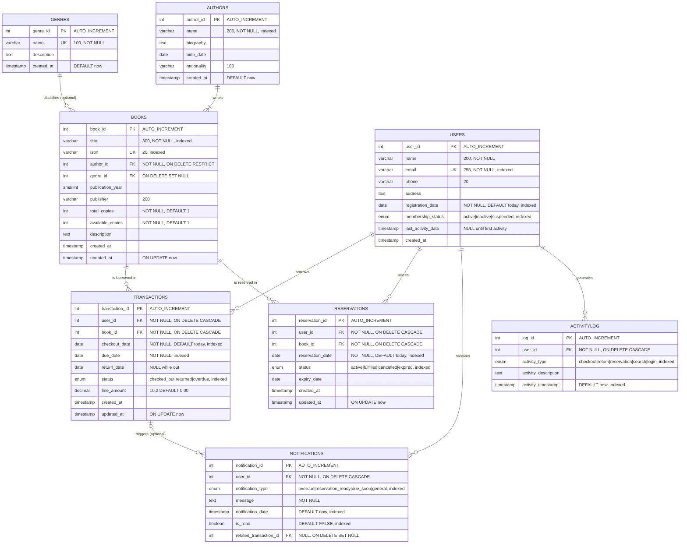

**`CHECK` constraints**

| Table | Rule |
| --- | --- |
| `Books` | `total_copies >= 0`, `available_copies >= 0`, `available_copies <= total_copies` |
| `Transactions` | `due_date >= checkout_date`, and `return_date IS NULL OR return_date >= checkout_date` |

These need MySQL 8.0.16 or newer, which is why the README states that minimum.

**Normal form.** Each table is in 3NF: authors and genres are separate entities instead of repeating text on `Books`, and every non-key column depends on the key, the whole key and nothing but the key. The one intentional redundancy is `Books.available_copies`, which is derivable from `total_copies` minus open loans and is kept as a stored counter so availability checks are a single row read.

---

## 2. Foreign keys and delete behaviour

What happens to child rows when a parent row is deleted. Arrows run from parent to child; the label is the `ON DELETE` rule.

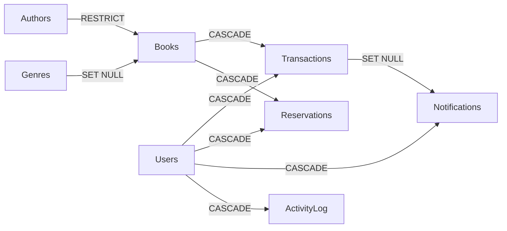

- **RESTRICT** on `Authors → Books`: an author with books cannot be deleted, so no book is ever orphaned.
- **SET NULL** on `Genres → Books` and `Transactions → Notifications`: the child survives without the link (a book can be uncategorised; a notification outlives its loan).
- **CASCADE** everywhere else: deleting a member or a book removes their loans, reservations, notifications and activity.

---

## 3. Status lifecycles

### Transaction (loan)

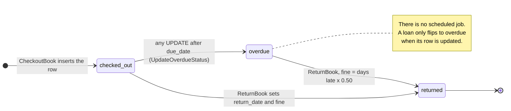

### Reservation

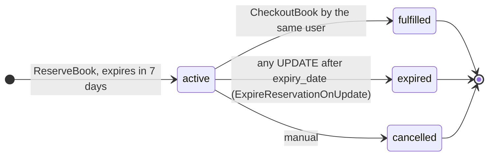

### Membership

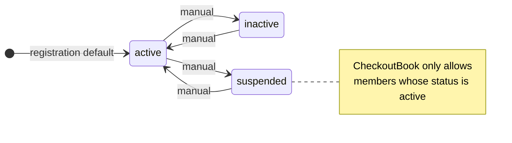

---

## 4. Stored procedure flows

Each procedure runs in its own `START TRANSACTION` and reports back through an `OUT p_result` parameter. Each also declares an `EXIT HANDLER FOR SQLEXCEPTION` that rolls everything back and returns `ERROR: Database error, nothing was changed`, so a failure never leaves a transaction open. Activity logging is left to the triggers (see [section 5](#5-trigger-map)) so each action is logged exactly once.

### `CheckoutBook(user_id, book_id, checkout_days, OUT result)`

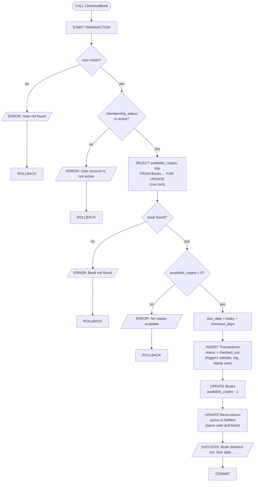

### `ReturnBook(transaction_id, OUT result)`

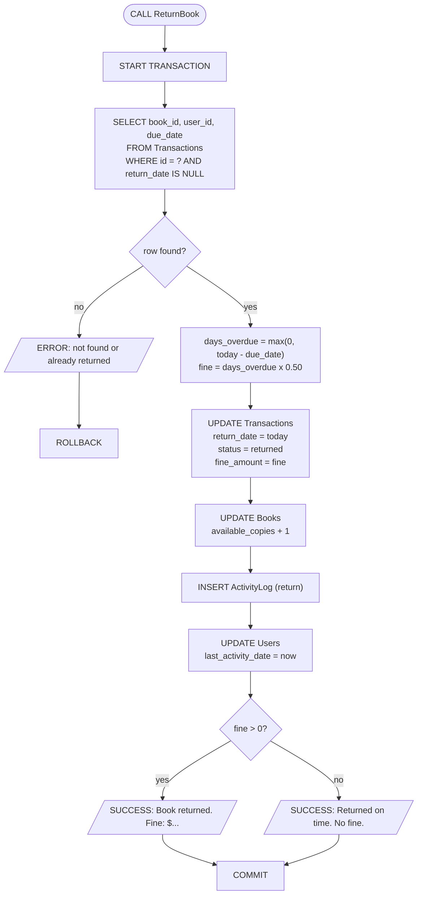

### `ReserveBook(user_id, book_id, OUT result)`

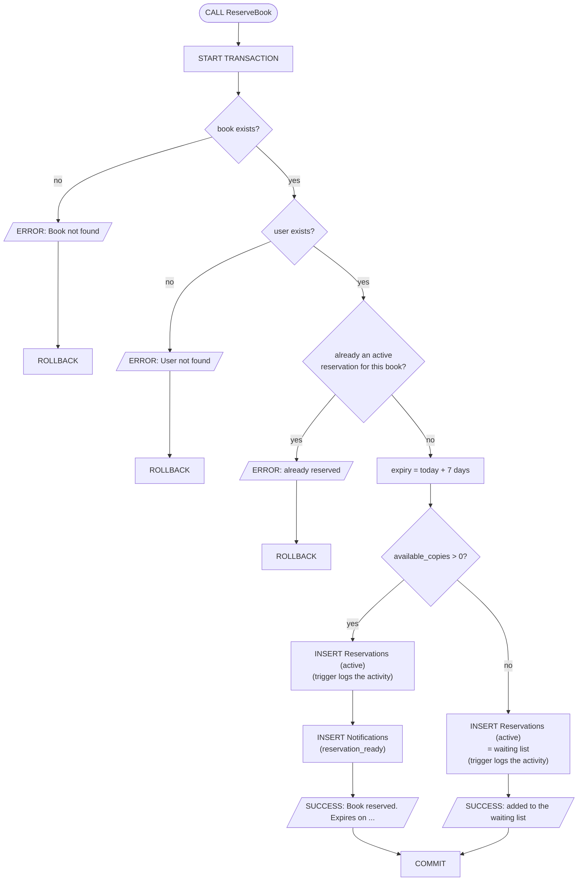

### `GetUserBorrowingHistory(user_id)`

A read-only procedure. It joins `Transactions → Books → Authors`, left-joins `Genres`, filters to one user and orders by `checkout_date` descending. It returns the transaction id, title, author, genre, checkout date, return date and status.

---

## 5. Trigger map

Eight triggers, grouped by the table and moment they fire on. `BEFORE` triggers can change or reject the row being written; `AFTER` triggers react to it.

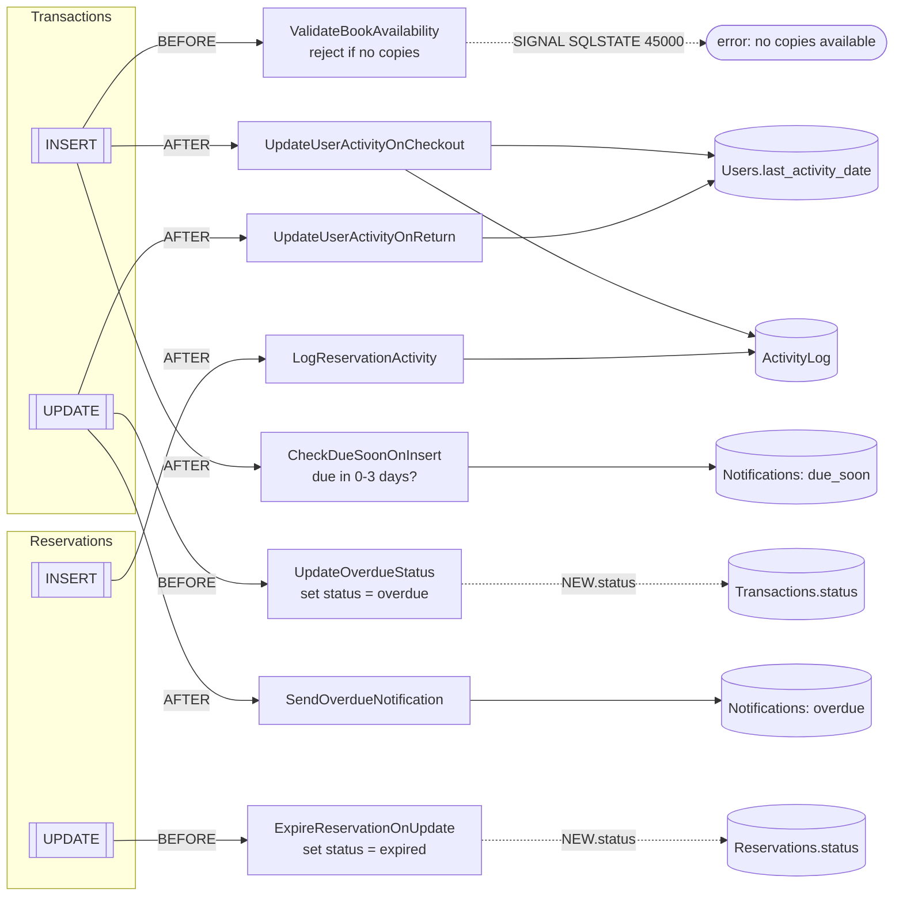

| Trigger | Table | When | What it does |
| --- | --- | --- | --- |
| `ValidateBookAvailability` | `Transactions` | BEFORE INSERT | Raises `SQLSTATE 45000` if the book's `available_copies <= 0`. |
| `UpdateUserActivityOnCheckout` | `Transactions` | AFTER INSERT | Stamps `Users.last_activity_date`; logs a `checkout` row. |
| `CheckDueSoonOnInsert` | `Transactions` | AFTER INSERT | If the due date is 0 to 3 days away, inserts a `due_soon` notification. |
| `UpdateOverdueStatus` | `Transactions` | BEFORE UPDATE | If not returned and past due, sets `status = 'overdue'`. |
| `SendOverdueNotification` | `Transactions` | AFTER UPDATE | When a loan becomes overdue, inserts an `overdue` notification. |
| `UpdateUserActivityOnReturn` | `Transactions` | AFTER UPDATE | When `return_date` is first set, stamps `last_activity_date`. |
| `ExpireReservationOnUpdate` | `Reservations` | BEFORE UPDATE | If active and past `expiry_date`, sets `status = 'expired'`. |
| `LogReservationActivity` | `Reservations` | AFTER INSERT | Logs a `reservation` row with the book title. |

---

## 6. Checkout end to end

What fires, and in what order, when a librarian checks a book out through `CheckoutBook`. The transaction row is inserted *before* the copy counter is decremented so that `ValidateBookAvailability` sees the real count and the last copy of a title can still be checked out.

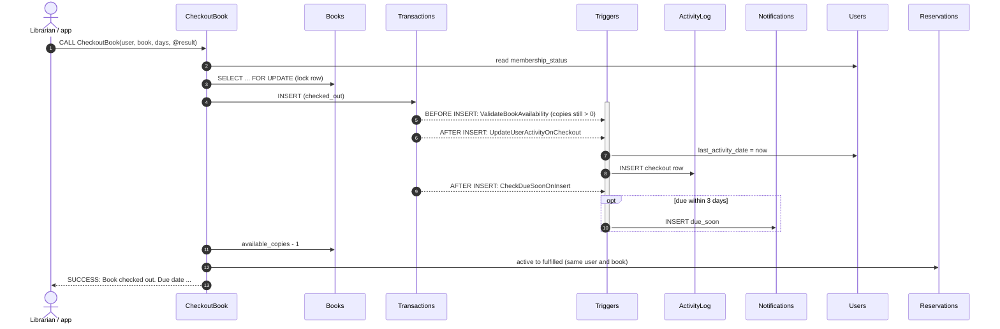

---

## 7. Views and the tables they read

Five views in [`05_queries_and_views.sql`](../database/05_queries_and_views.sql). Solid arrows are inner joins, dashed arrows are left joins.

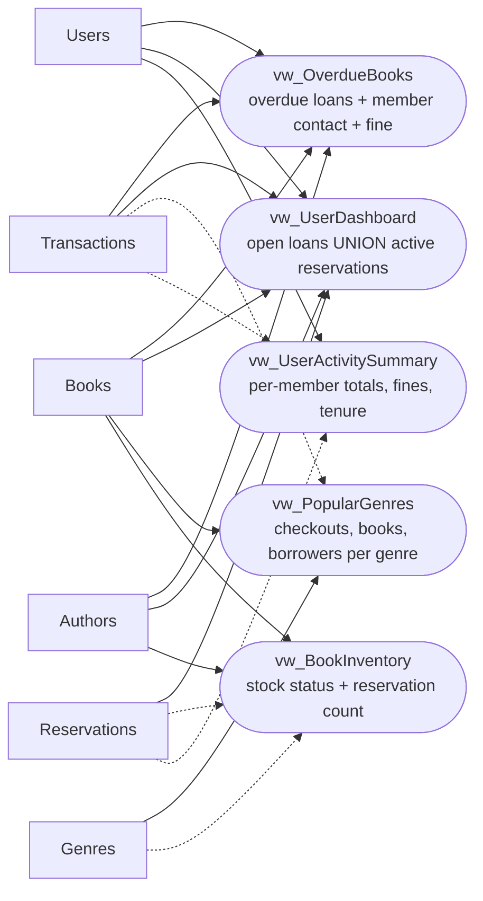

`vw_BookInventory` derives `stock_status` as **Out of Stock** (0 copies), **Low Stock** (at most 20% of total) or **In Stock**.

### Reports

[`06_reports.sql`](../database/06_reports.sql) holds ten analytics reports built on the same tables:

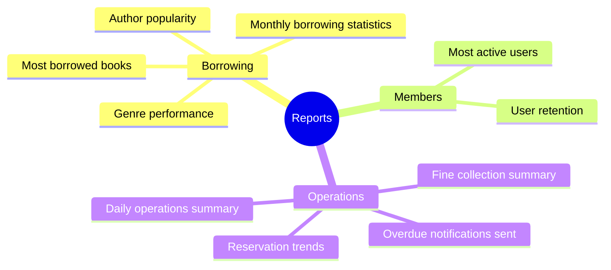

---

## 8. Desktop app

[`app/library_app.py`](../app/library_app.py) is a single-class Tkinter app (`LibraryManagementApp`) using `mysql-connector-python`. It reads the DB password from the `LMS_DB_PASSWORD` environment variable and connects to `localhost`.

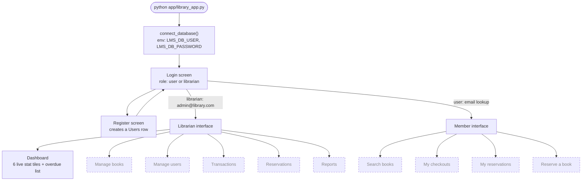

Solid boxes work today; dashed grey boxes are placeholders. The dashboard tiles run these counts live:

| Tile | Query |
| --- | --- |
| Total Books | `COUNT(*)` on `Books` |
| Available Books | `SUM(available_copies)` on `Books` |
| Active Users | `Users` where `membership_status = 'active'` |
| Books Checked Out | `Transactions` where `return_date IS NULL` |
| Overdue Books | `Transactions` where `status = 'overdue'` |
| Active Reservations | `Reservations` where `status = 'active'` |

Sign-in is a demo: members are matched by email only and the librarian account is hard-coded.

---

## 9. Build and setup order

The scripts depend on each other, so run them in this order. `01` drops and recreates the database.

```mermaid
flowchart LR
    A["01_create_tables.sql<br/>schema, keys, indexes, CHECKs"] --> B["02_insert_data.sql<br/>sample data"]
    B --> C["03_stored_procedures.sql<br/>4 procedures"]
    C --> D["04_triggers.sql<br/>8 triggers"]
    D --> E["05_queries_and_views.sql<br/>5 queries + 5 views"]
    E --> F["06_reports.sql<br/>10 reports (optional)"]
    F --> G["pip install -r app/requirements.txt"]
    G --> H["set LMS_DB_USER / LMS_DB_PASSWORD"]
    H --> I(["python app/library_app.py"])
```
